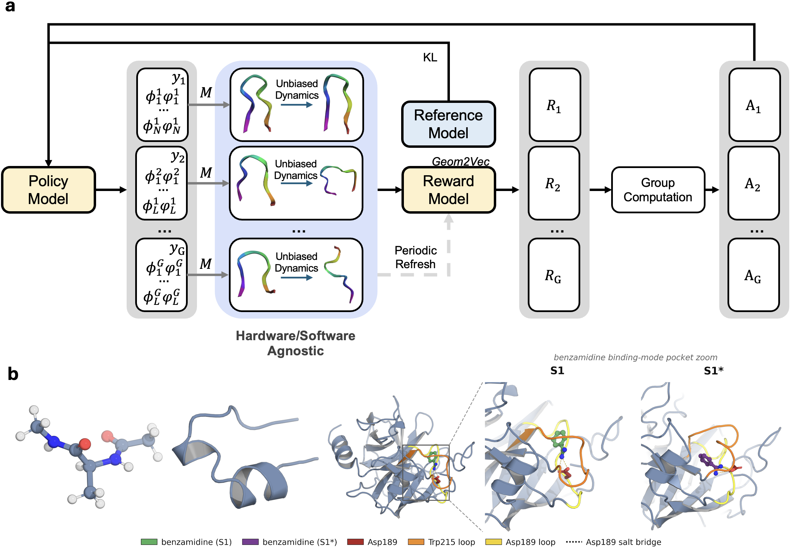
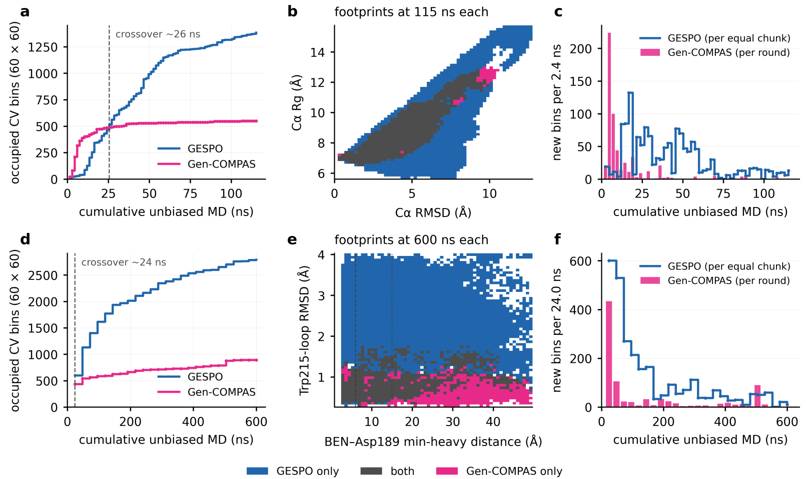

# GESPO

**Generative Enhanced Sampling by Policy Optimization**



*Figure 1. The GESPO loop and benchmark systems. A generative policy proposes
launch conformations; short unbiased trajectories supply kinetic rewards for
group-relative policy optimization.*

GESPO learns where to start molecular dynamics (MD) simulations. A generative
model proposes initial conformations, short unbiased trajectories test those
proposals, and reinforcement learning increases the probability of proposals
whose trajectories improve a learned kinetic model. The resulting loop directs
simulation toward metastable states and the dynamics connecting them.

**Read:** [Thesis (Chapter 7)](https://knowledge.uchicago.edu/records/jb5hq-9b189)
· [Defense slides (PowerPoint)](docs/slides/thesis_defense_powerpoint_final.pptx)

## GESPO and Gen-COMPAS

Both GESPO and [Gen-COMPAS (Tang et al., 2025)](https://arxiv.org/abs/2510.24979)
couple a molecular generator to unbiased MD. Gen-COMPAS focuses sampling near
the transition region between specified reactant and product states. GESPO
trains its generator on trajectory-level kinetic rewards to discover informative
launches across the conformational landscape, without requiring predefined end
states in its generative exploration mode.



*Coverage comparison from the [defense slides](docs/slides/thesis_defense_powerpoint_final.pptx), slide 26. Panels a–c: Trp-cage;
panels d–f: trypsin–benzamidine. Coverage counts occupied bins on a fixed 60 × 60
grid of collective variables. Blue: GESPO; pink: Gen-COMPAS; gray in the
footprints: regions visited by both.*

In these campaigns, Gen-COMPAS gains coverage quickly in its initial rounds,
then adds relatively few new bins. GESPO overtakes it at approximately 26 ns
for Trp-cage and 24 ns for trypsin, and continues discovering new regions.
At the equal production budgets shown in the figure:

| System | Unbiased MD per method | GESPO occupied bins | Gen-COMPAS occupied bins | Coverage ratio |
| --- | --- | --- | --- | --- |
| Trp-cage | 115 ns | ≈1,380 | ≈550 | ≈2.5× |
| Trypsin–benzamidine | 600 ns | ≈2,800 | ≈900 | ≈3× |

Counts and ratios are rounded from the figure. They measure coverage in these
projections, rather than equilibrium convergence, kinetic accuracy, or a
wall-clock speedup. The 600 ns trypsin comparison is a separate budget from the
720 ns full campaign summarized below.

The methods differ in how simulation outcomes determine the next launches:

| Aspect | Gen-COMPAS | GESPO generative exploration |
| --- | --- | --- |
| Launch criterion | Generate intermediates and select those near the learned committor separatrix, q⁺ ≈ 0.5. | Sample from a generative launch policy trained on trajectory-level rewards. |
| Generator update | Refit the diffusion model to accumulated configurations; refit the committor each round. | Pretrain on configurations, then optimize the policy with GRPO using kinetic rewards. |
| Endpoint information | Specified reactant and product states define the committor. | No predefined reactant/product pair is required. |

The central idea is **post-training a molecular generator on trajectory
outcomes**. Maximum-likelihood pretraining teaches the model to describe an
initial conformational ensemble; group-relative policy optimization (GRPO)
then teaches it which proposals lead to informative simulations. As trajectories
accumulate, both the generator and the kinetic model learn from the expanded
corpus.

The policy acts between simulations. Production trajectories evolve under the
chosen force field, with the launch restraints removed and no neural-network
evaluation in the force loop. This repository implements the MD stage with
OpenMM.

## How it works

Each training epoch consists of five steps:

1. **Propose.** An autoregressive transformer, TorsionAR, samples a group of
   reduced launch descriptions: global structural descriptors followed by protein
   backbone torsions and, for protein–ligand systems, ligand torsions. Gaussian
   mixture heads describe the global variables; von Mises mixture heads describe
   periodic angles. This gives an exact log-likelihood for each proposal, as
   needed for policy optimization.
2. **Realize.** A nearby configuration is retrieved from the trajectory bank and
   briefly restrained toward the proposal. Releasing the restraints yields an
   all-atom starting structure. The generator can propose beyond stored frames;
   realization still depends on the available bank and molecular geometry.
3. **Simulate.** Short, unbiased MD trajectories run from the realized structures
   in parallel.
4. **Score.** A kinetic model built on pretrained
   [Geom2Vec](https://github.com/zpengmei/geom2vec) features evaluates the
   trajectories in learned slow coordinates. The principal reward is each
   trajectory's leave-one-out contribution to the VAMP-2 score. Configurable
   coverage and transition-information terms encourage exploration.
5. **Update.** GRPO compares rewards within the group and updates the launch
   policy, with KL regularization toward a reference policy.

```text
Initial trajectories → Pretrain generator → Propose → Realize → Unbiased MD
                                               ↑                  │
                                               └── GRPO ← Reward ─┘

Between rounds: expand the trajectory bank, refit the generator, and repeat.
```

Geom2Vec supplies the representation for the kinetic reward model; the launch
policy generates torsions and global descriptors. The method therefore uses
structural descriptors without requiring a predefined reaction coordinate for
the generative exploration workflow. An optional
[path-sampling mode](docs/reference.md#path-sampling--committor) uses specified
endpoints and committor-based rewards.

The VAMP-2 contribution measures influence on the current empirical kinetic
score. It is a training signal, rather than a direct measure of the accuracy of
populations or rate constants.

## Reported applications

Chapter 7 of the [thesis](https://knowledge.uchicago.edu/records/jb5hq-9b189)
evaluates GESPO on three systems:

| System | Aggregate production MD | Findings |
| --- | --- | --- |
| Alanine dipeptide | 0.8 ns, in 2 ps segments | Canonical torsional basins and model-derived committors with qualitative correspondence to a matched reference. |
| Trp-cage | 115.2 ns, in 200 ps segments | Coverage from compact to extended conformations, with folding intermediates and an unfolded-to-folded committor. |
| Trypsin–benzamidine | 720 ns, in 2 ns segments | Native S1 and alternative S1* binding modes, encounter and dissociated configurations, and receptor rearrangements along model-derived binding/unbinding pathways. |

These are aggregate production budgets, excluding seed generation, structure
realization, and model training; they are not wall-clock timings. The bundled
examples illustrate the workflow and use settings that can differ from the
reported campaigns. In particular, the Trp-cage example uses implicit solvent,
whereas the reported campaign used explicit solvent.

**Statistical scope.** Adaptive launches change the distribution of collected
frames even though each production segment follows unbiased dynamics. Unweighted
histograms describe sampling coverage. Equilibrium populations, free energies,
and rate constants require suitable estimators and independent validation.
Committors and state networks are model estimates whose accuracy depends on
sampling, state definitions, and lag times.

## Installation

Use Python 3.10 or newer. The commands below create an environment for the CUDA
workflow used by the examples. Install a PyTorch build appropriate for your
hardware and its matching PyTorch Geometric dependencies, following the
[Geom2Vec installation instructions](https://github.com/zpengmei/geom2vec).

```bash
conda create -n gespo python=3.11 -y
conda activate gespo
conda install -c conda-forge openmm mdtraj -y

git clone https://github.com/zpengmei/GESPO.git
python -m pip install -e ./GESPO

# Geom2Vec is a separate package, with pretrained backbone checkpoints.
git clone https://github.com/zpengmei/geom2vec.git
python -m pip install -e ./geom2vec

cd GESPO
python -m gespo --help
```

Protein–ligand runs additionally require the ligand parameterization stack:

```bash
conda install -c conda-forge openmmforcefields openff-toolkit -y
```

For a `geom2vec_vamp` run, GESPO searches for a pretrained backbone checkpoint in
the Geom2Vec installation and known checkout locations. Pin a checkpoint for
reproducibility:

```bash
export GEOM2VEC_CKPT=/absolute/path/to/geom2vec/checkpoints/tensornet_l3_h64_rbf32_r5.pth
```

You can also pass `--geom2vec-ckpt` to a training command. See
[inputs and checkpoint discovery](docs/inputs.md) for details.

## Quickstart: a small protein in implicit solvent

Start with a prepared, hydrogen-added, protein-only PDB, such as folded
Trp-cage. Supply your own structure and the Geom2Vec checkpoint above; neither
is bundled in GESPO. Run these commands from the repository root in the activated
environment. This is an introductory workflow, with system-dependent sampling
and training settings.

```bash
export PDB=/absolute/path/to/trpcage.pdb

# 1. Generate an initial corpus with well-tempered metadynamics.
python -m gespo seed metad \
  --pdb "$PDB" --cv-set folding --implicit-solvent \
  --n-walkers 1 --device cuda:0 --production-ns 1 --out-dir seeds

# 2. Fit the generative launch policy to the seed conformations.
python -m gespo pretrain \
  --pdb "$PDB" --source seeds/walker_1 --out torsion_ar.pt \
  --global-token-set rmsd_e2e_rg --device cuda:0

# 3. Post-train the policy using short unbiased trajectories.
python -m gespo train \
  --pdb "$PDB" --generative-loop --implicit-solvent \
  --platform CUDA --gen-device cuda:0 \
  --torsion-ar-checkpoint torsion_ar.pt --projection geom2vec_vamp \
  --replay-only-dcd-dir seeds/walker_1 \
  --episodes 10 --grp-size 4 --n-md-steps 100000 \
  --snapshot-dir runs/round1
```

The biased seeds pretrain the policy and populate the retrieval bank. Importing
them with `--replay-only-dcd-dir` excludes them from VAMP fitting and the
leave-one-out kinetic reward. Keep biased seeding and realization segments
separate from unbiased production data in subsequent analysis.

For longer recipes, see
[Trp-cage folding](examples/protein_folding_trpcage/) and
[trypsin–benzamidine](examples/protein_ligand_trypsin/).

### Configuration and outputs

Generate a YAML template, fill in your inputs and run settings, then validate it:

```bash
python -m gespo config template --mode generative > my_run.yaml
# Edit my_run.yaml before validating or running it.
python -m gespo config validate my_run.yaml --strict
python -m gespo train --config my_run.yaml
```

Explicit CLI flags override YAML values. Use `python -m gespo train --help` for
the essential flags or `--help-all` for the full set.

The snapshot directory contains `effective_config.yaml`,
`simulation_topology.pdb`, per-epoch trajectory and reward records, and the
Geom2Vec/VAMP model outputs. Checkpoint locations are configurable. For another
round, refit the policy on accumulated data, expand the retrieval bank, and carry
forward the simulation topology so atom ordering remains consistent. Follow the
[multi-round workflow](docs/workflow.md#iterating-the-multi-round-protocol) for
the complete procedure.

## Python API

The same stages are available from Python:

```python
import gespo

gespo.generate_seeds(
    method="metad", pdb="trpcage.pdb", out_dir="seeds",
    cv_set="folding", n_walkers=1, explicit=False, production_ns=1,
)
gespo.pretrain_torsion_ar(
    source_path="seeds/walker_1", out_path="torsion_ar.pt",
    pdb_path="trpcage.pdb", global_token_set="rmsd_e2e_rg",
)
gespo.train("my_run.yaml")
```

Set the pretrained policy, replay inputs, solvent, and output paths in
`my_run.yaml` before training. `gespo.train` also accepts a dictionary or a
`TrainingConfig` object.

## Documentation

| Guide | Contents |
| --- | --- |
| [Inputs](docs/inputs.md) | Structure preparation, Geom2Vec installation, checkpoints, and topology consistency. |
| [Seeding](docs/seeding.md) | Metadynamics, high-temperature, and RMSD-biased seed generation. |
| [Workflow](docs/workflow.md) | End-to-end commands, outputs, and cumulative training rounds. |
| [Protein–ligand systems](docs/ligands.md) | Ligand preparation, parameterization, and pocket descriptors. |
| [Reference](docs/reference.md) | Token sets, reward terms, path sampling, CLI flags, and YAML fields. |
| [Geom2Vec integration](gespo/projections/geom2vec/README.md) | Embeddings, caching, and VAMP training. |
| [Examples](examples/) | Configurations and scripts for folding and protein–ligand sampling. |

The implementation is organized into `gespo/policies/` for launch models,
`gespo/loops/` and `gespo/training/` for optimization,
`gespo/sampling/` for OpenMM and realization, and `gespo/projections/` and
`gespo/rewards/` for kinetic representations and scoring.

## Citation

If you use GESPO, please cite the thesis. Chapter 7 describes the method and its
applications.

> Zihan Pengmei. *Representation and Reinforcement Learning for Molecular
> Dynamics*. PhD dissertation, The University of Chicago (2026).
> [doi:10.6082/jb5hq-9b189](https://doi.org/10.6082/jb5hq-9b189).

```bibtex
@phdthesis{pengmei2026representation,
  author = {Pengmei, Zihan},
  title = {Representation and Reinforcement Learning for Molecular Dynamics},
  school = {The University of Chicago},
  year = {2026},
  doi = {10.6082/jb5hq-9b189},
  url = {https://knowledge.uchicago.edu/records/jb5hq-9b189}
}
```
